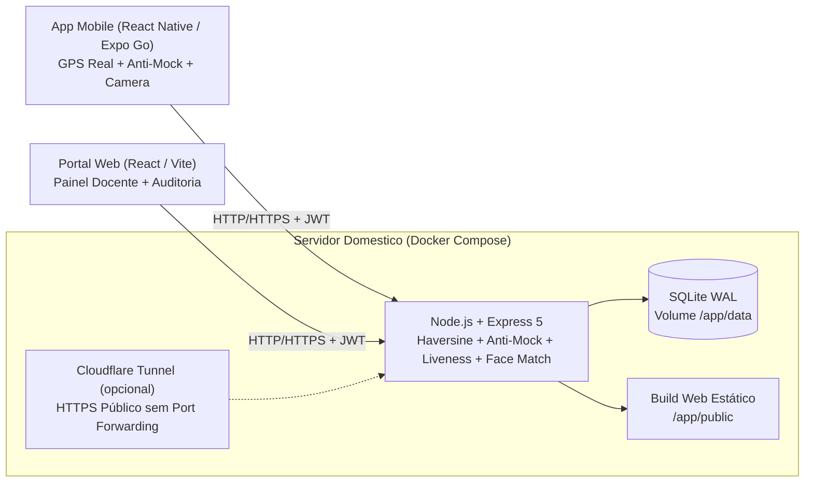

# 🎓 UGB Presença — Sistema de Registro de Presença Acadêmica por Geolocalização e Reconhecimento Facial

**Trabalho de Conclusão de Curso (TCC) — Engenharia de Software**  
**Instituição:** Centro Universitário Geraldo Di Biase (UGB) — Volta Redonda, RJ (2026)  
**Autores:** Pedro Henrique Teixeira Dornellas Soares de Souza & Pedro Gabriel da Costa Ribeiro

---

## 🎯 Sobre o Projeto

A chamada manual em instituições de ensino superior consome em média **5 a 10 minutos por aula** e está sujeita a falhas operacionais e fraudes (assinatura por terceiros). O **UGB Presença** resolve o problema com **validação em duas etapas estritas** executadas em tempo real:

1. **Etapa 1 — Cerco Geográfico (Geofencing) + Anti-Mock Location:**
   - Cálculo geodésico via **Fórmula de Haversine (WGS-84)** verificando se a distância `d ≤ raio_sala`.
   - **Detecção Anti-Mock Location** nativa no React Native (`expo-location` `location.mocked`) + heurísticas no back-end (precisão artificial `0.0m` e anomalias de velocidade de deslocamento).
2. **Etapa 2 — Reconhecimento Facial + Prova de Vida (Liveness Detection):**
   - Desafio dinâmico gerado pelo servidor (`POST /api/attendance/liveness-challenge`) com token de uso único (proteção contra *replay attacks*).
   - Captura de **2 quadros sequenciais** (antes e pós-desafio) com detecção de imagem estática no back-end.
   - Comparação real por **Similaridade de Cosseno** contra o vetor biométrico facial cadastrado pelo aluno no banco **SQLite** (com limiar ajustável pelo docente).
3. **Rastreabilidade & Auditoria:**
   - Controle de **1ª Presença (Início)** e **2ª Presença (Final)** com janela automática de **20 minutos**.
   - Comprovante digital com **Assinatura Criptográfica SHA-256**, código verificável (`GET /api/attendance/verify/:code`), QR Code e exportação CSV.
   - Painel de Telemetria com latência da API (ms), taxa biométrica, precisão do GPS, fraudes bloqueadas e tempo letivo economizado.

---

## 🏗️ Arquitetura e Stack

| Camada | Tecnologia | Função |
| --- | --- | --- |
| **App Mobile** (`mobile/`) | **React Native (Expo SDK 58)** | Interface Aluno e Professor, GPS nativo + Anti-Mock (`expo-location`) e Câmera (`expo-camera`) |
| **Portal Web** (`client/`) | **React + Vite + Tailwind CSS** | Painel Docente para projeção em sala, Auditoria, Simulador Haversine e Exportação CSV |
| **Back-End** (`server/`) | **Node.js 22 + Express 5** | API RESTful, Autenticação JWT + bcrypt, Motor Biométrico (pure-JS), Anti-Fraude e Haversine |
| **Banco de Dados** | **SQLite (`better-sqlite3`, WAL)** | Persistência relacional leve em volume Docker (`/app/data/presenca_tcc.sqlite`) |
| **Infraestrutura** | **Docker & Docker Compose** | Deploy 24/7 em servidor doméstico (x86_64 e ARM64) + perfil opcional Cloudflare Tunnel (HTTPS) |



---

## 📁 Estrutura do Repositório

```text
├── Dockerfile                 # Build multi-stage (Web + Node.js + SQLite nativo)
├── docker-compose.yml         # Orquestração servidor doméstico + Cloudflare Tunnel opcional
├── .env.example               # Modelo de variáveis de ambiente
├── package.json               # Scripts de atalho na raiz
├── server/                    # API Node.js + Express + SQLite
│   ├── index.js               # Servidor HTTP, CORS, Helmet, Healthcheck e static Web
│   ├── database.js            # Schema relacional SQLite, migrations e seed UGB
│   ├── haversine.js           # Fórmula de Haversine (WGS-84)
│   ├── antifraud.js           # Anti-Mock Location e heurísticas GPS
│   ├── biometrics.js          # Extração de vetor facial, Liveness 2 quadros e Cosseno
│   ├── middleware/auth.js     # Autenticação JWT + controle de perfis
│   ├── routes/                # auth, sessions, attendance, courses, rooms, analytics
│   └── tests/api.test.js      # Suíte automatizada E2E (10 cenários completos)
├── client/                    # Portal Web React + Vite (servido pelo próprio Docker)
└── mobile/                    # Aplicativo React Native (Expo Go Android/iOS)
```

---

## 🐳 Deploy no Servidor Doméstico com Docker

### 1. Subindo na Rede Local (LAN / Wi-Fi)

No seu servidor doméstico (Linux, mini PC, Raspberry Pi ou Windows com Docker):

```bash
git clone https://github.com/dornellasz93/TCC.git
cd TCC
cp .env.example .env
# Edite o JWT_SECRET no .env se desejar
docker compose up -d --build
```

Verifique se está saudável:

```bash
docker compose ps
curl http://localhost:5000/api/health
```

- **Portal Web + API:** `http://<IP_DO_SEU_SERVIDOR>:5000`
- **Banco SQLite persistido** no volume Docker `ugb_presenca_sqlite_data` (`/app/data/presenca_tcc.sqlite`).

### 2. Expondo com HTTPS Grátis via Cloudflare Tunnel (Recomendado!)

> **Por que usar HTTPS?** No app React Native (Expo Go), HTTP na rede local funciona normalmente. Porém, para acessar a câmera e o GPS pelo **navegador** fora de `localhost`, ou para acessar o seu servidor doméstico da faculdade pela internet (4G/Wi-Fi da UGB), o **Cloudflare Tunnel** fornece HTTPS automático **sem abrir portas no roteador doméstico**.

1. Crie um Tunnel gratuito em [Cloudflare Zero Trust](https://one.dash.cloudflare.com) -> **Networks -> Tunnels**.
2. Configure o *Public Hostname* (ex: `tcc.seudominio.com`) apontando para o serviço interno `http://ugb-presenca:5000`.
3. Cole o token no arquivo `.env` em `CLOUDFLARE_TUNNEL_TOKEN=...`.
4. Suba com o perfil `tunnel`:

```bash
docker compose --profile tunnel up -d --build
```

---

## 📱 Executando o App Mobile (React Native / Expo Go)

1. Instale o aplicativo **Expo Go** no seu smartphone Android ou iOS.
2. No computador de desenvolvimento:

```bash
cd mobile
npm install
npx expo start
```

3. Escaneie o QR Code no Expo Go.
4. Na tela de login do app, toque na barra superior **`Configurar Servidor Docker`**:
   - Digite o endereço do servidor Docker (ex: `http://192.168.1.50:5000` ou `https://tcc.seudominio.com`).
   - Toque em **Testar** para confirmar a conexão (`/api/health`) e depois em **Salvar & Conectar**.

---

## 💻 Desenvolvimento Local (Sem Docker)

```bash
# 1. Instalar dependências
npm --prefix server install
npm --prefix client install
npm --prefix mobile install

# 2. Rodar testes automatizados do back-end
npm run test:server

# 3. Terminal 1 — API Node.js + SQLite (porta 5000)
npm run dev:server

# 4. Terminal 2 — Portal Web (porta 3000 com proxy para 5000)
npm run dev:web

# 5. Terminal 3 — App React Native (Expo)
npm run mobile
```

---

## 👤 Contas Pré-Cadastradas para Demonstração (Senha: `123`)

| Perfil | Matrícula | E-mail | Senha |
| --- | --- | --- | --- |
| 👨‍🏫 **Professor** (Prof. Dr. Geraldo Di Biase Filho) | `DOC-1001` | `geraldo.dibiase@ugb.edu.br` | `123` |
| 👨‍🏫 **Professora** (Profª. Me. Luciana Martins) | `DOC-1002` | `luciana.martins@ugb.edu.br` | `123` |
| 👨‍🎓 **Aluno** (Pedro Henrique Dornellas) | `2024102278` | `pedro.dornellas@ugb.edu.br` | `123` |
| 👨‍🎓 **Aluno** (Pedro Gabriel Ribeiro) | `2024102279` | `pedro.gabriel@ugb.edu.br` | `123` |

---

## 🎤 Roteiro Sugerido para a Apresentação da Banca (26/11)

1. **Preparação (5 min antes):**
   - Abra o Portal Web no projetor (`http://<servidor>:5000`) logado como **Prof. Geraldo (`DOC-1001`)**.
   - Abra o **App React Native (Expo Go)** no celular apontando para o servidor Docker.
   - *(Opcional GPS Real ao vivo)*: Logue como Professor no celular e toque em **"Calibrar GPS desta Sala com Este Celular"** — agora o cerco geográfico da Sala 204 passa a ser exatamente a sala da banca!
2. **Cadastro Biométrico Real (30s):**
   - No celular, entre como **Pedro Henrique (`2024102278`)**, toque em **"Cadastre sua Biometria Facial"** e tire uma selfie. O servidor salva o vetor biométrico real no SQLite.
3. **Demonstração Anti-Fraude (1 min):**
   - Inicie o registro da **1ª Presença**:
     - Teste **Pátio/Em Casa** -> toque em **"Testar Bloqueio no Servidor"** -> mostra HTTP 403 `OUT_OF_GEOFENCE`.
     - Teste **Fake GPS (Mock Location)** -> mesmo com 0m de distância, o servidor bloqueia com `MOCK_LOCATION_DETECTED`.
4. **Registro Legítimo em 2 Etapas (1 min):**
   - Selecione **GPS Real** (se calibrou a sala) ou **Na Carteira (Sala 204)** -> Etapa 1 aprovada!
   - Na Etapa 2, mostre o **Desafio Dinâmico de Prova de Vida** gerado pelo servidor -> capture Quadro 1 -> faça o gesto -> capture Quadro 2 -> **Presença Confirmada com Comprovante SHA-256**!
5. **Painel Docente & Telemetria no Projetor (1 min):**
   - Mostre no projetor a presença aparecendo em tempo real na tabela do Professor.
   - Encerre a **1ª Presença** e abra a **2ª Presença** (provando a regra sequencial e o timer de 20 min).
   - Abra a aba **Auditoria & Telemetria**: mostre os KPIs (latência ms, precisão GPS, fraudes bloqueadas, tempo letivo devolvido), valide o código `UGB-P1-XXXXX` no validador criptográfico e baixe o **CSV oficial**.

---

## 📄 Licença

Projeto acadêmico desenvolvido para o curso de Engenharia de Software do Centro Universitário Geraldo Di Biase (UGB).
